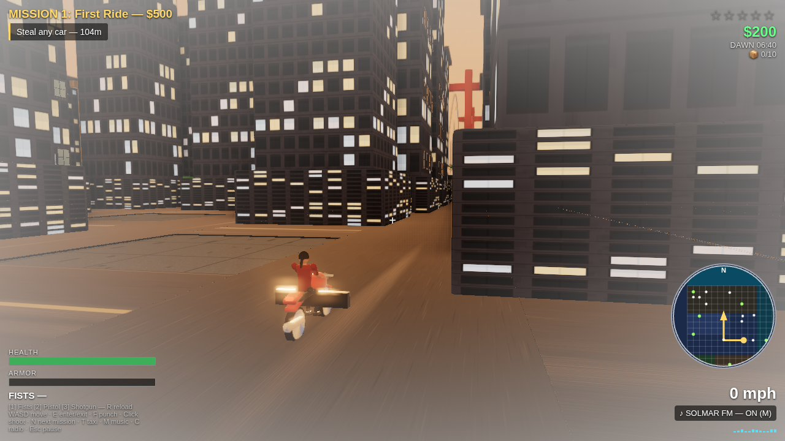

# SOLMAR

An original open-world crime game for the make.fun **GTA6-01** competition.
Mara Solis, ex-stunt driver turned getaway driver, takes five jobs across the
coastal city of Solmar — cars, bikes, boats, a bank vault, and a five-star
escape by water. All names, art, and sound are original; nothing from
Rockstar Games. Every texture is procedural canvas work, every sound is
WebAudio synthesis, and the whole game runs offline from static files.

## Play

Serve `game/` locally (any static server, e.g. `node serve.ts`) and open
http://localhost:8080 — or open `game/index.html` directly in desktop Chrome.

| Key | Action |
| --- | --- |
| WASD | Move / drive |
| Mouse drag | Orbit camera |
| Shift | Run |
| Space | Jump / handbrake (in vehicle) |
| E | Enter / exit vehicle |
| Click | Fire armed weapon |
| 1 / 2 / 3 | Fists / pistol / shotgun |
| R | Reload |
| F | Punch |
| N | Next mission |
| T | Taxi fare (near a pedestrian) |
| M | Music on/off |
| C | Next radio station |
| Esc / P | Pause |

## The city

16×16 blocks, four districts — Downtown (skyscrapers, helipad), Marina &
Beach (boardwalk, lighthouse, docks), Old Town (plazas, vendor stalls),
Port & Industrial (cranes, containers, suspension bridge) — plus a hill-top
park viewpoint. Four fixed times of day: dawn, noon, dusk rain, night.

## Missions

1. **First Ride** — steal a car, reach the garage ($500)
2. **Beach Run** — motorcycle delivery against the clock ($800)
3. **Bank Job** — grab cash at three points, escape a 3-star chase ($1,500)
4. **Storm Chase** — survive 45 seconds at 4 stars: roadblock, spike strip,
   helicopter ($2,000)
5. **The Last Boat** — escape by speedboat to the lighthouse ($3,000)

Side work: taxi fares and 10 hidden packages ($250 each). Wanted level
0–5: police cars, foot cops, helicopter with searchlight, roadblocks,
spike strips, and police boats. Progress saves to localStorage.

## Screenshots

Deterministic staging: `?shot=dawn|heist|storm|night&seed=7` — each stages
its scene and sets `window.__shotReady` when composed.

## Tech

- three.js 0.160.0, vendored under `game/vendor/` (no network requests)
- RoundedBoxGeometry + beveled ExtrudeGeometry throughout, 1024px
  procedural canvas textures (map / normal / roughness), MeshPhysicalMaterial
  layer stack (clearcoat / sheen / transmission / anisotropy)
- Post chain: SSAO + UnrealBloom (threshold 0.9) + FXAA + vignette,
  ACES tone mapping, PMREM environment per time of day, PCF soft shadows
- Seeded RNG (mulberry32, seed 7) so every staged shot is reproducible

## License

MIT — see `LICENSE`.
